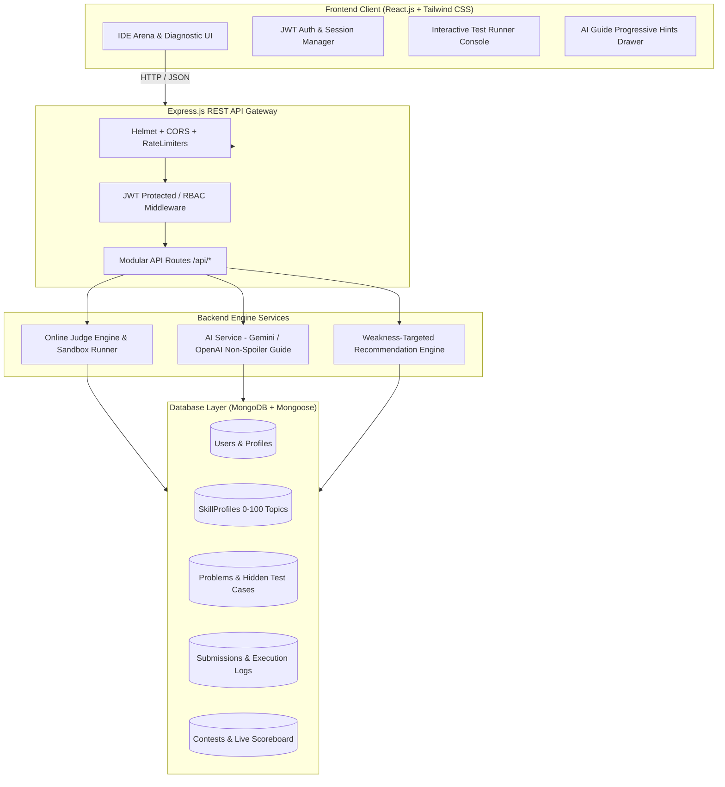

# ⚔️ Coding Arena

> **AI-Powered Competitive Programming & Personalized Algorithmic Learning Platform**  
> Built with React, Node.js/Express, MongoDB, and an isolated Online Judge Engine with LLM-powered non-spoiler tutoring.

---

## 🏛️ System Architecture



---

## 🚀 Key Features

### 1. 🎯 Diagnostic Skill Onboarding & SkillProfile
- **Adaptive Diagnostic Quiz**: New coders answer multi-topic conceptual and algorithmic pattern questions.
- **Calibrated Numerical Scores (0–100)**: Maps proficiency across 8 core competitive topics:
  - *Arrays*
  - *Strings*
  - *Dynamic Programming*
  - *Graphs*
  - *Trees*
  - *Searching & Sorting*
  - *Math & Logic*
  - *Greedy*
- **Dynamic Strengths & Weaknesses Detection**: Automatically isolates areas $< 50\%$ and marks key strengths $\ge 65\%$.

### 2. 🧠 Weakness-Targeted Recommendation Engine (`/api/recommendations`)
- Continuously examines the student's `SkillProfile`.
- Queries unsolved challenges specifically targeting their lowest proficiency areas.
- Dynamically scales difficulty (Easy $\to$ Medium $\to$ Hard) to bridge skill gaps without overwhelming.

### 3. ⚖️ Online Judge Execution Engine (`/api/judge`)
- **Multi-Language Sandboxed Execution**: Evaluates code in **JavaScript (Node.js)**, **Python 3**, **C++**, and **Java**.
- **Accurate Resource Measurement**: Measures execution runtime (ms) via high-resolution timers (`performance.now()`) and memory usage.
- **Execution Classifications**:
  - `Accepted (AC)`: Output passes all testcases within constraints.
  - `Wrong Answer (WA)`: Output divergence detected against expected test output.
  - `Time Limit Exceeded (TLE)`: Process exceeded maximum threshold (e.g. 3,000ms).
  - `Runtime Error (RE)`: Stack overflow, null pointer, or uncaught exception.
  - `Compilation Error (CE)`: Syntax build failure.
- **Victory Celebrations**: Interactive confetti bursts on Accepted submissions!

### 4. 🤖 AI Algorithmic Tutor & Non-Spoiler Hints (`/api/ai/hint`)
- **Pedagogical Guardrails**: Built with strict instructions **never** to output full working solution code.
- **Three-Tier Progressive Hint Ladder**:
  - **Tier 1 (Conceptual Intuition)**: High-level perspective and time/space tradeoff.
  - **Tier 2 (Edge Cases & Data Structures)**: Identifies tricky inputs, boundary conditions, and auxiliary storage structures.
  - **Tier 3 (Algorithmic Invariant)**: Mathematical recurrence relation or step-by-step invariant guidance.
- **Dual Engine**: Direct integration with **Google Gemini API** & **OpenAI API**, alongside an internal **Adaptive Heuristic Engine** for offline/zero-config operation.

### 5. 🏆 Contest Arena & Live Standings (`/api/contests`)
- Real-time countdown clocks for **Active**, **Upcoming**, and **Past** contests.
- Tournament registration tracking.
- Penalty scoring system: 10-minute penalty per incorrect submission, real-time leaderboard snapshots.

---

## 📂 Project Directory Structure

```
coding_arena_webapp/
├── backend/
│   ├── src/
│   │   ├── config/
│   │   │   ├── db.js                 # Resilient MongoDB connector (with in-memory fallback)
│   │   │   └── env.js                # Environment variables and defaults
│   │   ├── models/
│   │   │   ├── User.js               # User auth, rating, points, and solved counters
│   │   │   ├── SkillProfile.js       # Topic-wise proficiency (0-100) & assessment history
│   │   │   ├── Problem.js            # Description, constraints, sample & hidden test cases
│   │   │   ├── Submission.js         # Runtime, memory, status (AC, WA, TLE, RE), code
│   │   │   ├── Contest.js            # Tournament schedule, problems, and live scoreboard
│   │   │   └── AssessmentQuestion.js # Diagnostic onboarding quiz questions
│   │   ├── middleware/
│   │   │   ├── auth.js               # JWT verification & RBAC authorization
│   │   │   ├── errorMiddleware.js    # Global exception handler & 404 catcher
│   │   │   └── rateLimiter.js        # Rate limiters (Auth, Judge, AI, General)
│   │   ├── services/
│   │   │   ├── judgeService.js       # Secure sandboxed execution engine
│   │   │   ├── aiService.js          # Gemini/OpenAI wrapper with non-spoiler prompting
│   │   │   └── recommendationService.js # Weakness-targeted problem recommendation
│   │   ├── controllers/
│   │   │   ├── authController.js
│   │   │   ├── assessmentController.js
│   │   │   ├── problemController.js
│   │   │   ├── judgeController.js
│   │   │   ├── aiController.js
│   │   │   ├── recommendationController.js
│   │   │   ├── contestController.js
│   │   │   └── leaderboardController.js
│   │   ├── routes/
│   │   │   ├── authRoutes.js
│   │   │   ├── assessmentRoutes.js
│   │   │   ├── problemRoutes.js
│   │   │   ├── judgeRoutes.js
│   │   │   ├── aiRoutes.js
│   │   │   ├── recommendationRoutes.js
│   │   │   ├── contestRoutes.js
│   │   │   └── leaderboardRoutes.js
│   │   ├── data/
│   │   │   └── seedData.js           # Comprehensive seed script (10+ problems, contests, coders)
│   │   └── server.js                 # Express app, Helmet, CORS, and auto-seeder
│   ├── .env.example
│   └── package.json
├── frontend/
│   ├── src/
│   │   ├── components/
│   │   │   ├── Navbar.jsx            # Header with live stats and navigation
│   │   │   ├── ProtectedRoute.jsx    # Authentication route guard
│   │   │   ├── CodeEditor.jsx        # Line numbers, auto-close, indentation handling
│   │   │   ├── TerminalOutput.jsx    # Sample testcases, custom input, and logs
│   │   │   ├── AIHintSidebar.jsx     # Tiered progressive hints drawer
│   │   │   ├── SkillRadarChart.jsx   # Numerical topic proficiency visualization
│   │   │   ├── CountdownTimer.jsx    # Real-time ticking contest timer
│   │   │   └── StatCard.jsx          # Glassmorphism dashboard metric card
│   │   ├── context/
│   │   │   └── AuthContext.jsx       # Auth state, session persistence, and token handling
│   │   ├── services/
│   │   │   └── api.js                # Axios client with automatic Bearer JWT injection
│   │   ├── pages/
│   │   │   ├── Login.jsx             # Dark login screen with one-click demo profiles
│   │   │   ├── Signup.jsx            # Registration screen
│   │   │   ├── Assessment.jsx        # Diagnostic quiz interface and results view
│   │   │   ├── Dashboard.jsx         # Personalized workspace and recommendation queue
│   │   │   ├── ProblemList.jsx       # Problem catalog with multi-tag filtering
│   │   │   ├── Arena.jsx             # Split-screen Coding IDE with AI Tutor integration
│   │   │   ├── Contests.jsx          # Contest hub with registration and standings modal
│   │   │   └── Leaderboard.jsx       # Global hall of fame with podium rankings
│   │   ├── App.jsx                   # React Router hierarchy
│   │   ├── main.jsx                  # React DOM entry
│   │   └── index.css                 # Custom dark theme styles and scrollbars
│   ├── tailwind.config.js
│   ├── vite.config.js
│   └── package.json
└── package.json                      # Monorepo root scripts
```

---

## 🛠️ Getting Started

### 1. Prerequisites
- **Node.js**: v18.0.0 or higher
- **MongoDB**: Local MongoDB instance running on `localhost:27017` **OR** a free [MongoDB Atlas](https://www.mongodb.com/atlas) connection URI.

---

### 2. Installation

Install all backend and frontend dependencies:
```bash
# From the root directory:
npm run install:all
```

Or individually:
```bash
cd backend && npm install
cd ../frontend && npm install
```

---

### 3. Environment Configuration

Copy `.env.example` to `.env` in the `backend/` directory:
```bash
cd backend
cp .env.example .env
```

Configure your environment variables:
```env
PORT=5000
MONGODB_URI=mongodb://127.0.0.1:27017/coding_arena
JWT_SECRET=your_super_secret_jwt_key_here
JWT_EXPIRES_IN=7d
CLIENT_URL=http://localhost:5173

# Optional: Add your Gemini or OpenAI API key here
# If left blank, the built-in Adaptive Heuristic Engine will generate hints automatically!
GEMINI_API_KEY=
OPENAI_API_KEY=

JUDGE_TIME_LIMIT_MS=3000
```

---

### 4. Seed the Database

Populate the database with pre-configured algorithmic problems, diagnostic assessment questions, sample contests, and demo user accounts:
```bash
# In backend directory:
npm run seed
```

---

### 5. Running the Application

Start backend and frontend development servers:

**Terminal 1 (Backend API & Judge Engine):**
```bash
cd backend
npm run dev
# Server running at http://localhost:5000
```

**Terminal 2 (Frontend Client):**
```bash
cd frontend
npm run dev
# App running at http://localhost:5173
```

---

## 🧪 Demo User Accounts (Pre-Seeded)

| Role | Email | Password | Rating | Specialty |
| :--- | :--- | :--- | :--- | :--- |
| **Grandmaster** | `alex@arena.dev` | `password123` | 1980 | Dynamic Programming Master |
| **Expert** | `sarah@arena.dev` | `password123` | 1820 | Graph Theory & Trees |
| **Intermediate** | `david@arena.dev` | `password123` | 1540 | Arrays & Sorting (Needs DP practice) |
| **New Student** | `demo@codingarena.io` | `password123` | 1250 | Diagnostic Assessment Pending |

---

## 📡 REST API Reference

### Authentication (`/api/auth`)
- `POST /api/auth/register` — Register a new account and initialize default `SkillProfile`.
- `POST /api/auth/login` — Authenticate credentials and return JWT bearer token.
- `GET /api/auth/me` — Return current logged-in user profile, rating, and skill profile.
- `PUT /api/auth/profile` — Update user bio, avatar, and github links.

### Diagnostic Assessment (`/api/assessment`)
- `GET /api/assessment/questions` — Fetch diagnostic questions for initial assessment.
- `POST /api/assessment/submit` — Submit answers, evaluate topic proficiency scores, and update `SkillProfile`.
- `GET /api/assessment/profile` — Fetch topic scores, strengths, weaknesses, and assessment logs.

### Problems Catalog (`/api/problems`)
- `GET /api/problems` — Filter problems by `topic`, `difficulty`, `search`, and pagination.
- `GET /api/problems/:slug` — Retrieve full problem text, constraints, templates, and sample testcases.
- `POST /api/problems` — Admin route to create a new challenge.

### Online Judge Sandbox (`/api/judge`)
- `POST /api/judge/run` — Run code against sample testcases or custom inputs in an isolated sandbox.
- `POST /api/judge/submit` — Official evaluation against the complete hidden test suite; calculates runtime, memory, awards points, and updates contest leaderboards.
- `GET /api/judge/submissions/:problemId` — Retrieve submission history for a problem.

### AI Algorithmic Tutor (`/api/ai`)
- `POST /api/ai/hint` — Analyze student's failing code and error log to produce progressive 3-tier non-spoiler hints.

### Recommendation Engine (`/api/recommendations`)
- `GET /api/recommendations` — Fetch personalized problems targeting the student's lowest topic proficiencies.

### Contests Center (`/api/contests`)
- `GET /api/contests` — List active, upcoming, and past contests with countdown metadata.
- `GET /api/contests/:id` — Retrieve contest problem set and registered participants.
- `POST /api/contests/:id/register` — Register current user for a contest.
- `GET /api/contests/:id/leaderboard` — Real-time contest scoreboard with penalty times.

### Global Leaderboard (`/api/leaderboard`)
- `GET /api/leaderboard` — Paginated global rankings sorted by score points and contest ratings.

---

## 🛡️ Security & Performance Highlights
1. **Isolated Sandboxing**: Node.js `vm` contexts and separate subprocess timeouts prevent infinite loops and memory exhaustion attacks.
2. **Rate Limiting**: Multi-tier rate limits (`express-rate-limit`) protect sensitive endpoints (submissions, authentication, and AI generation) against DoS.
3. **HTTP Header Hardening**: Helmet with adjusted Content Security Policies (CSP) to support code editor workers.
4. **CORS Control**: Configured origin validation protecting cookies and JWT headers.
5. **No Solution Code Spoilers**: Strict system prompt constraints ensure AI acts as an educational Socratic tutor rather than a solution generator.

---

## 📄 License
MIT License. Built for algorithmic problem solvers and competitive programmers.
